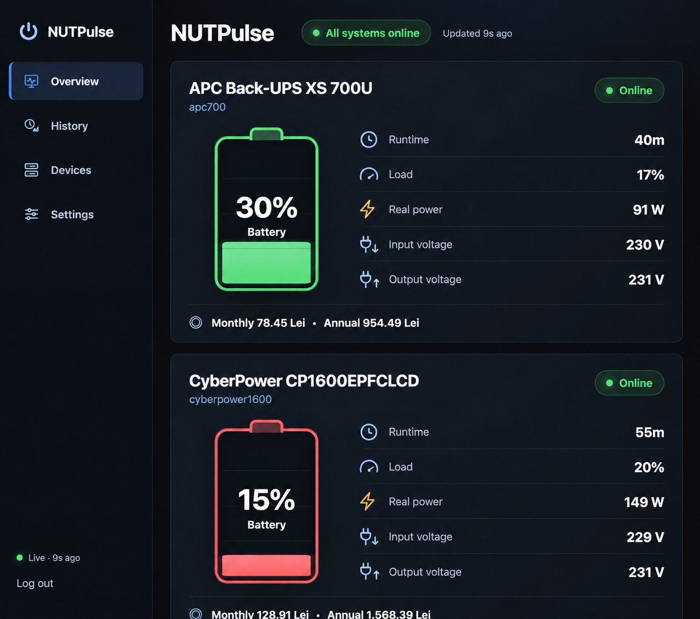
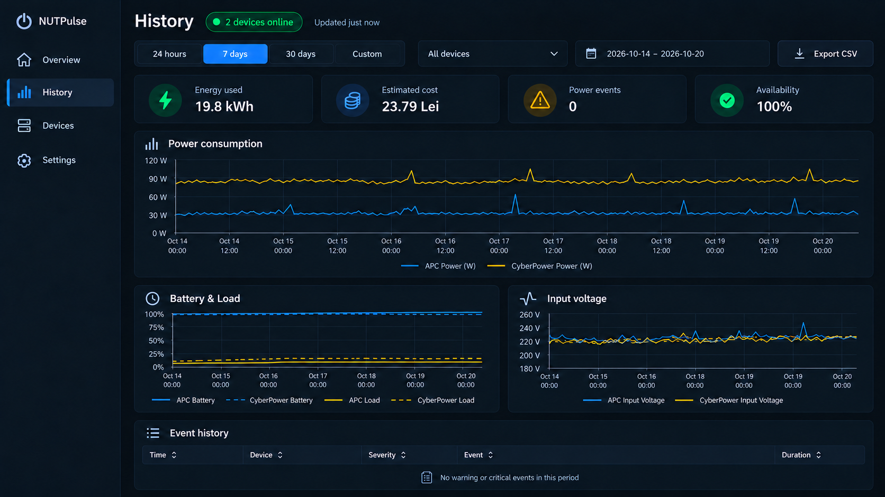
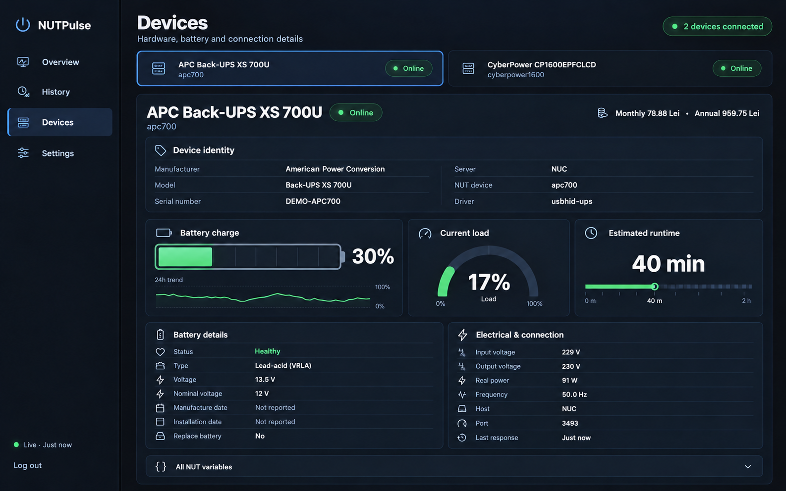
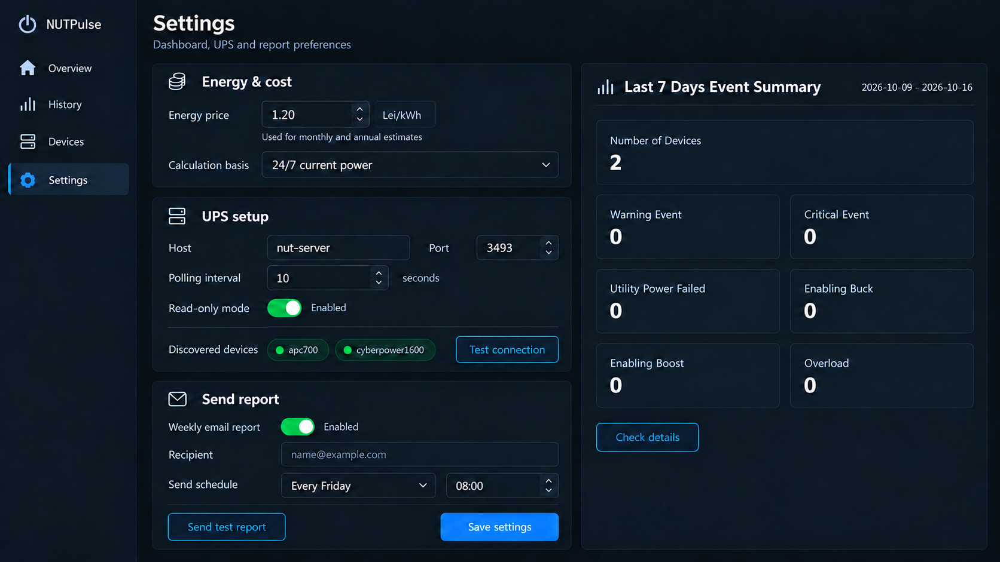

# NUTPulse

**A modern, read-only dashboard for [Network UPS Tools](https://networkupstools.org/).**

NUTPulse connects to an existing NUT server and turns UPS telemetry into a focused dashboard with live status, historical charts, per-device energy costs, battery details, event history, and weekly reports.

It does not configure UPS hardware and does not send control commands to NUT.

Docker images are published at [Docker Hub](https://hub.docker.com/r/romeolazar/nutpulse) for `linux/amd64` and `linux/arm64`. Use `romeolazar/nutpulse:latest` for the current release or `romeolazar/nutpulse:0.1.0` for a pinned deployment.

## Screenshots

All screenshots use fictional demonstration data.

| Overview | History |
| --- | --- |
|  |  |

| Device details | Settings |
| --- | --- |
|  |  |

## Features

- Automatic discovery of all UPS devices exposed by one NUT server
- Live battery, runtime, load, power, voltage, and status information
- Detailed per-device identity, battery health, electrical data, and raw NUT variables
- Historical charts for power, battery, load, and input voltage
- Monthly and annual energy-cost estimates for each UPS
- Warning and critical event history
- Weekly HTML e-mail report preview and optional SMTP delivery
- Cookie-based web authentication
- Responsive desktop and mobile interface
- SQLite persistence with configurable retention
- Docker-first deployment

## Read-only by design

NUTPulse only uses the NUT protocol commands required to discover and read devices:

- `LIST UPS`
- `LIST VAR <ups>`

It does not issue `INSTCMD`, `SET`, forced shutdown, or UPS control commands.

## Requirements

- Docker with Docker Compose
- An existing NUT server reachable from the container
- One or more UPS devices exposed by that server

## Quick start

```bash
git clone https://github.com/romeolazar/NUTPulse.git
cd NUTPulse
cp .env.example .env
```

Edit `.env` and set at least:

```dotenv
NUT_HOST=nut-server
NUT_SERVER_NAME=NUT Server
WEB_PASSWORD=choose-a-strong-password
AUTH_SECRET=replace-with-a-long-random-value
```

Generate a suitable authentication secret with:

```bash
python3 -c 'import secrets; print(secrets.token_urlsafe(48))'
```

Start the application:

```bash
docker compose pull
docker compose up -d
```

Open <http://127.0.0.1:9001> and sign in with the username and password from `.env`.

## Configuration

| Variable | Default | Description |
| --- | --- | --- |
| `NUT_HOST` | `nut-server` | NUT server hostname or address |
| `NUT_SERVER_NAME` | `NUT Server` | Friendly server name shown in Devices |
| `NUT_PORT` | `3493` | NUT server TCP port |
| `NUT_POLL_INTERVAL` | `10` | Polling interval in seconds |
| `ENERGY_PRICE` | `1.20` | Initial energy price per kWh |
| `TZ` | `UTC` | Application timezone |
| `RAW_SAMPLE_RETENTION_DAYS` | `90` | Raw sample retention period |
| `WEB_USERNAME` | `admin` | Dashboard username |
| `WEB_PASSWORD` | required | Dashboard password |
| `AUTH_SECRET` | required | Secret used to sign sessions |
| `COOKIE_SECURE` | `false` | Set to `true` behind HTTPS |
| `SMTP_*` | empty | Optional weekly-report SMTP configuration |

Settings saved from the interface are stored in the application database and take precedence over the corresponding initial defaults.

## Persistent data

SQLite data is stored in the Docker volume `nutpulse_data`. Back up this volume before upgrades.

The database, `.env`, logs, and runtime configuration are intentionally excluded from version control.

## Production notes

- Use a unique, strong `WEB_PASSWORD` and `AUTH_SECRET`.
- Serve NUTPulse through HTTPS and enable `COOKIE_SECURE=true`.
- Restrict the NUT server so it is reachable only from trusted networks or containers.
- Do not publish `.env`, database files, SMTP credentials, UPS serial numbers, or internal addresses.
- Review `compose.production.example.yaml` before deployment.

## Development checks

```bash
python3 -m unittest discover -s tests -v
python3 -c 'from pathlib import Path; [compile(path.read_text(), str(path), "exec") for path in Path("app").glob("*.py")]'
docker compose config --quiet
```

## License and third-party software

NUTPulse is released under the [MIT License](LICENSE). Third-party notices are documented in [THIRD_PARTY_NOTICES.md](THIRD_PARTY_NOTICES.md).
